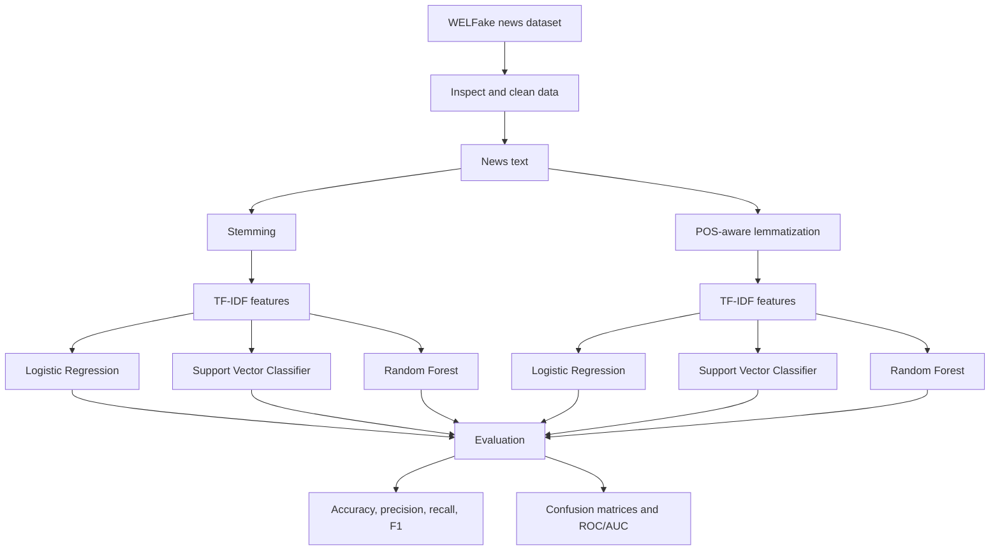

# Fake News Detector

<p align="center">
  <strong>Machine learning for NLP-based fake news classification.</strong>
  <br />
  A comparative notebook project exploring how text normalization, TF-IDF features, and classical classifiers can be used to classify news articles as real or fake.
</p>

<p align="center">
  
  
  
  
</p>

---

## Overview

Fake News Detector is a natural-language-processing and machine-learning project that studies whether the text of a news article can be classified as **real** or **fake**. The main experiment uses the WELFake dataset and compares multiple feature-preprocessing and classifier combinations.

The notebook explores the full workflow: data inspection, text cleaning, linguistic normalization, TF-IDF feature extraction, supervised model training, and classification evaluation.

> **Important:** This is a text-classification experiment, not a fact-checking authority. Predictions reflect patterns learned from a dataset and may be wrong, biased, or outdated. Verify important claims with reliable sources.

## ML pipeline



[Editable Mermaid pipeline](docs/diagrams/pipeline.mmd)

## Methodology

### 1. Dataset and preprocessing

The notebook uses the **WELFake Dataset**. It inspects the data, handles missing values, and cleans article text by normalizing content and removing unwanted characters. The data is split into training and test sets using an 80/20 split with stratification to preserve the label distribution.

Check the original dataset source for download details and licensing before redistributing it.

### 2. Stemming vs. lemmatization

The project evaluates two text-normalization approaches:

- **Stemming:** uses the Porter Stemmer to reduce words to stems.
- **Lemmatization:** uses WordNet lemmatization with part-of-speech information to reduce words to dictionary forms.

These alternatives are compared to study how text normalization changes the representation passed to a classifier.

### 3. TF-IDF feature extraction

TF-IDF (Term Frequency–Inverse Document Frequency) converts article text into sparse numerical features. It weights terms based on their usefulness within a document relative to the wider corpus.

### 4. Classifiers

The notebook compares three supervised learning algorithms with both feature-processing strategies:

| Model | Role in the experiment |
| --- | --- |
| Logistic Regression | Linear classification baseline |
| Support Vector Classifier (SVC) | Margin-based classification |
| Random Forest | Ensemble of decision trees |

This creates six model/preprocessing combinations for comparison, assuming each combination was run successfully in the notebook.

## Evaluation

The notebook imports and uses classification evaluation metrics, including:

- **Accuracy:** fraction of examples classified correctly.
- **Precision:** among examples predicted as fake, the share that are actually labeled fake.
- **Recall:** among examples labeled fake, the share identified by the model.
- **F1-score:** harmonic mean of precision and recall.
- **Confusion matrix:** shows false positives and false negatives.
- **ROC curve and AUC:** evaluates discrimination across classification thresholds where supported by the model output.

No headline score is claimed here because the exact final metric values were not verified from the notebook outputs. Add metrics from the latest completed test-set evaluation rather than estimating or inventing them.

## Repository contents

```text
Fake-news-Detector/
├── Fake news detector.ipynb       # EDA, preprocessing, model comparison and evaluation
├── README.md
├── lr_stem_model.joblib            # Saved Logistic Regression model (stemming)
├── lr_lem_model (1).joblib         # Saved Logistic Regression model (lemmatization)
├── svm_stem_model.joblib           # Saved SVC model (stemming)
├── svm_lem_model.joblib            # Saved SVC model (lemmatization)
├── vectorizer_lem (1).joblib       # Saved lemmatization TF-IDF vectorizer
└── fakenewsai                      # Existing project artifact
```

The existing files use slightly inconsistent names. A model and vectorizer must come from the same preprocessing pipeline; a vectorizer fitted on lemmatized text should not be assumed compatible with a model trained on stemmed text.

## Getting started

### Requirements

- Python
- Jupyter Notebook or JupyterLab
- NumPy, pandas, scikit-learn, NLTK, Matplotlib, Seaborn, WordCloud
- `scikit-learn-intelex` is used as an optional scikit-learn acceleration package in the notebook

Create an environment and install the main dependencies:

```bash
python -m venv .venv
source .venv/bin/activate   # macOS/Linux
# .venv\Scripts\activate    # Windows

python -m pip install --upgrade pip
python -m pip install numpy pandas scikit-learn nltk matplotlib seaborn wordcloud scikit-learn-intelex jupyter
```

### Run the notebook

```bash
git clone https://github.com/anjani24/Fake-news-Detector.git
cd Fake-news-Detector
jupyter notebook "Fake news detector.ipynb"
```

The notebook was originally run in a Kaggle environment where the dataset was available under `/kaggle/input/`. For local use, download the WELFake CSV from its original source and update the notebook's data path accordingly.

NLTK may require downloadable resources for tokenization, POS tagging, stopwords, and WordNet lemmatization. Follow the notebook's errors/prompts if any resources are missing.

## Loading a saved model

Saved `.joblib` artifacts are present. For inference, the vectorizer must match the preprocessing and model used during training.

```python
import joblib

model = joblib.load("lr_stem_model.joblib")

# Load a vectorizer trained for the SAME stemming pipeline.
# Replace this path with the matching stemmed vectorizer artifact
# once it is available in the repository.
vectorizer = joblib.load("path/to/matching_stem_vectorizer.joblib")

articles = ["A sample news headline to classify."]
features = vectorizer.transform(articles)
predictions = model.predict(features)

print(predictions)
```

The listed artifacts include a lemmatized vectorizer but no clearly named stemmed vectorizer. Do not pair artifacts from different pipelines without confirming their training configuration.

Only load trusted `.joblib` files. Pickle-based formats can execute code when loading untrusted or tampered artifacts.

## Interpretation and limitations

- A model learns associations in the training dataset; it does not independently verify facts or sources.
- Dataset artifacts and writing styles can create shortcuts that do not generalize to new events or publishers.
- Text-only input omits source reputation, external evidence, publication context and subsequent corrections.
- Performance should be checked on a properly held-out set and, ideally, on newer or externally sourced examples.
- Precision and recall matter differently depending on the cost of falsely flagging genuine reporting versus missing misinformation.
- Model/vectorizer compatibility and preprocessing consistency are required for valid inference.

## Future improvements

- [ ] Export a complete, versioned inference pipeline (preprocessor + vectorizer + classifier).
- [ ] Add a reusable prediction script with input validation.
- [ ] Record test-set metrics for all model/preprocessing combinations.
- [ ] Add cross-validation and error analysis on misclassified examples.
- [ ] Evaluate on newer data to test temporal generalization.
- [ ] Add a reproducible dependency file and automated notebook/build checks.
- [ ] Explore source-aware or evidence-retrieval features without treating model predictions as ground truth.

## Tech stack

Python · pandas · NumPy · NLTK · scikit-learn · TF-IDF · Logistic Regression · SVC · Random Forest · Matplotlib · Seaborn · WordCloud · Jupyter Notebook

---

If you use this project, cite the WELFake dataset at its original source and report the exact experimental setup alongside any performance numbers.
