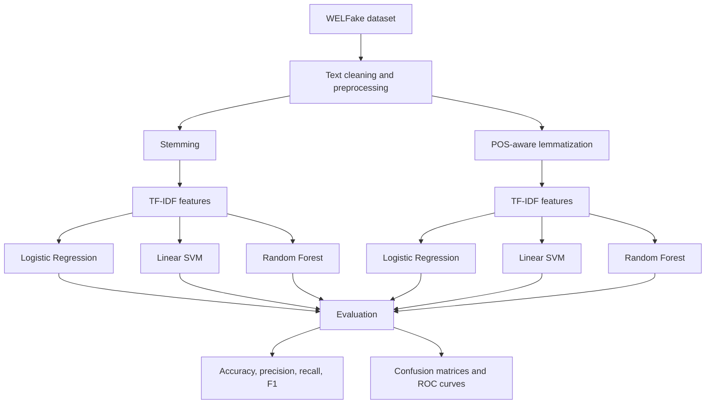
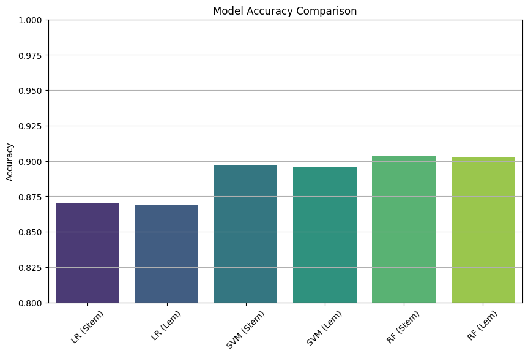

# Fake News Detector

<p align="center">
  <strong>NLP-based fake news classification using classical machine learning.</strong>
  <br />
  A comparative study of stemming vs. lemmatization, TF-IDF features, and three classifiers on the WELFake dataset.
</p>

<p align="center">
  
  
  
  
</p>

---

## Overview

Fake News Detector is a machine-learning project that classifies news text as **real (label 0)** or **fake (label 1)**. The notebook explores data inspection, text preprocessing, TF-IDF feature extraction, model training, and evaluation.

The experiment compares **Logistic Regression, Support Vector Machine (SVM), and Random Forest**, each with two text-normalization strategies: stemming and lemmatization.

> **Important:** This is a text-classification prototype, not an independent fact-checking system. Its output reflects patterns learned from the dataset and can be wrong. Verify consequential claims with reliable sources.

## Architecture



Editable diagram source: [`docs/diagrams/pipeline.mmd`](docs/diagrams/pipeline.mmd).

## Dataset and experiment setup

- **Dataset:** WELFake Dataset, loaded in the original notebook from `WELFake_Dataset.csv`.
- **Train/test split:** 80% training and 20% test data, with stratification.
- **Test set:** 14,427 examples (7,006 labeled `0`, 7,421 labeled `1`).
- **Feature extraction:** TF-IDF.
- **Text processing:** stemming and POS-aware lemmatization.
- **Classifiers:** Logistic Regression, linear-kernel SVC, and Random Forest.

## Results

The table below reproduces the accuracy values and weighted F1-scores from the notebook's classification reports. Results are on the same 14,427-example test split.

| Model | Text processing | Accuracy | Weighted F1 |
| --- | --- | ---: | ---: |
| Logistic Regression | Stemming | 87.00% | 0.87 |
| Logistic Regression | Lemmatization | 86.86% | 0.87 |
| SVM (linear kernel) | Stemming | 89.67% | 0.90 |
| SVM (linear kernel) | Lemmatization | 89.55% | 0.90 |
| **Random Forest** | **Stemming** | **90.31%** | **0.90** |
| Random Forest | Lemmatization | 90.25% | 0.90 |

**Best reported result:** Random Forest with stemming achieved **90.31% accuracy** and a **0.90 weighted F1-score**. Random Forest with lemmatization was close at 90.25%.

### Per-class performance

| Model / processing | Class | Precision | Recall | F1-score | Support |
| --- | ---: | ---: | ---: | ---: | ---: |
| Logistic Regression / stemming | 0 | 0.87 | 0.86 | 0.86 | 7,006 |
| Logistic Regression / stemming | 1 | 0.87 | 0.88 | 0.87 | 7,421 |
| Logistic Regression / lemmatization | 0 | 0.87 | 0.85 | 0.86 | 7,006 |
| Logistic Regression / lemmatization | 1 | 0.87 | 0.88 | 0.87 | 7,421 |
| SVM / stemming | 0 | 0.91 | 0.88 | 0.89 | 7,006 |
| SVM / stemming | 1 | 0.89 | 0.92 | 0.90 | 7,421 |
| SVM / lemmatization | 0 | 0.91 | 0.88 | 0.89 | 7,006 |
| SVM / lemmatization | 1 | 0.89 | 0.91 | 0.90 | 7,421 |
| Random Forest / stemming | 0 | 0.91 | 0.89 | 0.90 | 7,006 |
| Random Forest / stemming | 1 | 0.90 | 0.91 | 0.91 | 7,421 |
| Random Forest / lemmatization | 0 | 0.91 | 0.89 | 0.90 | 7,006 |
| Random Forest / lemmatization | 1 | 0.90 | 0.92 | 0.91 | 7,421 |

In this notebook's label convention, class `0` is real news and class `1` is fake news. Precision and recall should be interpreted with that convention in mind.

## Visual analysis

The notebook includes label-distribution and word-frequency visualizations, a model-accuracy comparison, six confusion matrices, and ROC curves. The original notebook is the authoritative place to inspect each plot alongside the code that generated it.

### Model comparison



### Confusion matrices

The notebook output includes confusion matrices for all six model/preprocessing combinations. These are saved as individual figures in [`docs/images/`](docs/images/).

### ROC curves

ROC plots are also extracted from the notebook output and included in [`docs/images/`](docs/images/). Refer to the notebook for each plot's model label and plotting code.

## Methodology

### 1. Text normalization

Two approaches are compared:

- **Stemming:** uses the Porter Stemmer to reduce words to stems.
- **Lemmatization:** uses WordNet lemmatization with part-of-speech information to reduce words to dictionary forms.

### 2. TF-IDF

TF-IDF converts text into sparse numerical vectors, emphasizing terms that are informative within a document relative to the corpus.

### 3. Classification models

- **Logistic Regression:** linear baseline classifier.
- **SVM (linear kernel):** margin-based classifier.
- **Random Forest:** ensemble of decision trees.

### 4. Evaluation

The notebook evaluates accuracy, precision, recall, F1-score, confusion matrices, and ROC curves. Using multiple metrics helps expose trade-offs that a single accuracy value can hide.

## Repository contents

```text
Fake-news-Detector/
├── Fake news detector.ipynb       # Data analysis, training, evaluation and plots
├── README.md
├── lr_stem_model.joblib
├── lr_lem_model (1).joblib
├── svm_stem_model.joblib
├── svm_lem_model.joblib
├── vectorizer_lem (1).joblib
└── fakenewsai                     # Existing project artifact
```

The repository includes serialized model artifacts. Check the notebook's model-saving cell for the exact model/vectorizer filenames and ensure the preprocessing pipeline matches at inference time. A stemmed model should not be paired with a lemmatized vectorizer (or vice versa).

## Run the notebook

```bash
git clone https://github.com/anjani24/Fake-news-Detector.git
cd Fake-news-Detector
python -m pip install numpy pandas scikit-learn nltk matplotlib seaborn wordcloud autocorrect scikit-learn-intelex jupyter
jupyter notebook "Fake news detector.ipynb"
```

The notebook was originally run in Kaggle and reads the dataset from a `/kaggle/input/` path. For local execution, download the WELFake CSV from its original source and update the dataset path in the notebook. NLTK may also require downloaded tokenizer, stopword, POS-tagging, and WordNet resources.

## Limitations and responsible use

- A high test score on one dataset does not establish reliable performance on current news, unseen publishers, or different domains.
- Text-only classification does not verify facts against evidence or assess source credibility.
- Dataset artifacts and writing-style correlations can inflate apparent performance on examples similar to the training set.
- The results should be treated as experimental and should not be used alone to label a person or publisher as intentionally spreading misinformation.
- The notebook output shows convergence warnings for Logistic Regression; consider investigating convergence and documenting the final model configuration.

## Future improvements

- [ ] Export a complete inference pipeline with the matching text preprocessing, vectorizer, and classifier.
- [ ] Add a small prediction script with input validation.
- [ ] Use cross-validation and error analysis to assess stability.
- [ ] Test on newer, externally collected news to measure temporal generalization.
- [ ] Record dependency versions and add reproducible environment setup.
- [ ] Explore evidence retrieval or source context while keeping predictions clearly separate from fact verification.

## Tech stack

Python · pandas · NumPy · NLTK · scikit-learn · TF-IDF · Logistic Regression · SVM · Random Forest · Matplotlib · Seaborn · WordCloud · Jupyter Notebook

---

Dataset source and usage terms should be credited according to the original WELFake dataset listing. Report the test split and exact experimental setup whenever citing these scores.
